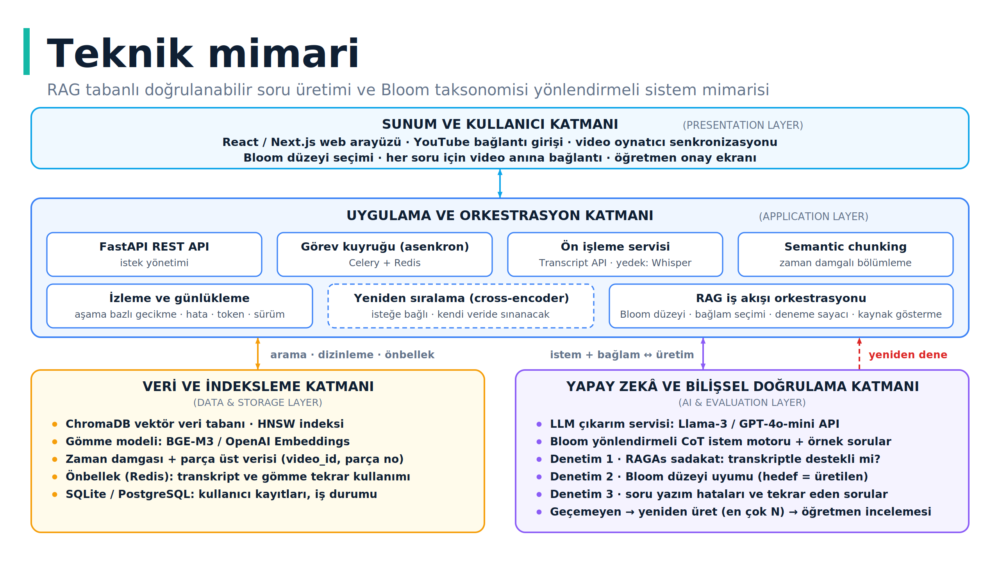

# Video Soru Üretici

YouTube ders videolarının bağlantısından zaman damgalı transkript çıkaran, transkriptten **kaynağı gösterilebilir ve doğrulanabilir** sorular üreten bir web uygulaması. Bitirme projesi olarak aşama aşama geliştirilmektedir.

> Soruların amacı resmî sınav değil, **alıştırma ve hızlı tanı**dır. Her soru videonun ilgili anına bağlanır ve öğretmen onayından geçer.

## Hedef akış

```
YouTube URL → transkript (zaman damgalı) → bölümleme → özet
            → Bloom düzeyine göre soru üretimi (RAG)
            → otomatik doğrulama (sadakat · Bloom uyumu · yazım hataları)
            → öğretmen onayı → videonun ilgili anına bağlı sorular
```

## Mimari

Dört katmanlı yapı: Sunum, Uygulama ve Orkestrasyon, Veri ve İndeksleme, Yapay Zekâ ve Bilişsel Doğrulama.



Tasarım kararlarının literatür gerekçeleri: [docs/01-literatur-degerlendirmesi.docx](docs/01-literatur-degerlendirmesi.docx)

## Aşamalar

Yol haritası ve her aşamanın kaydı: [docs/yol-haritasi.md](docs/yol-haritasi.md) · [docs/ilerleme-gunlugu.md](docs/ilerleme-gunlugu.md)

## Kurulum (backend)

```bash
cd backend
python -m venv .venv && source .venv/bin/activate   # Windows: .venv\Scripts\activate
pip install -r requirements.txt
cp ../.env.example ../.env                          # anahtarları .env içine yaz
uvicorn app.main:app --reload
```

Testler: `cd backend && pytest`

API dokümantasyonu: http://localhost:8000/docs

## Teknolojiler

| Katman | Seçim |
|---|---|
| Backend | Python, FastAPI |
| Transkript | youtube-transcript-api (yedek: Whisper) |
| LLM | OpenAI GPT-4o-mini |
| Vektör DB | ChromaDB, gömme: BGE-M3 |
| Kuyruk / önbellek | Celery + Redis |
| Frontend | React / Next.js |
